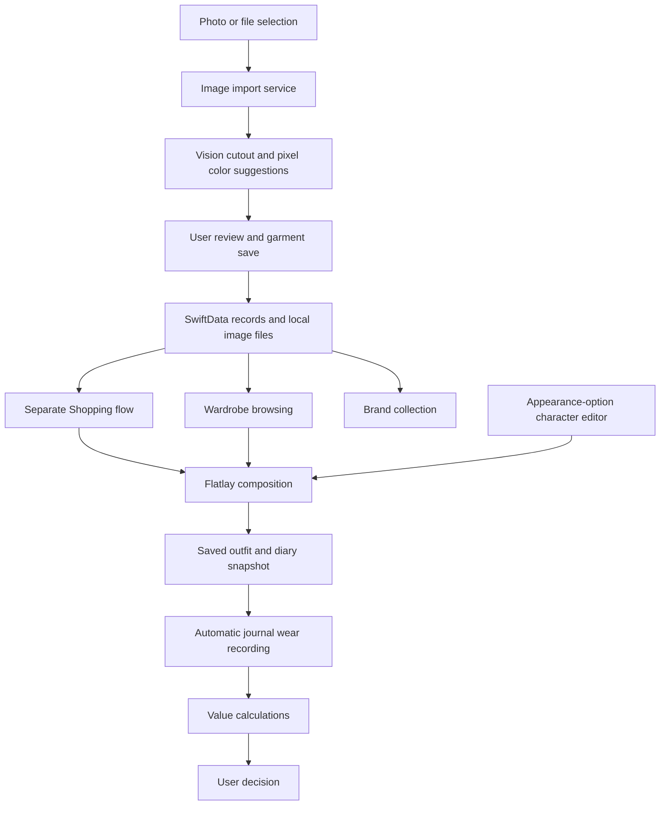

## Interaction Rules

- Canvas gestures belong to the whole canvas. A pinch may start with one finger on the selected sticker and one outside it. Two-finger scale/rotation takes precedence over a one-finger edge/corner drag. Only the selected layer changes; one completed gesture makes one undo step. Handle drags use their original touch-down point, and canceled gestures restore the previous arrangement.
- Existing brand profiles switch between view and edit in the same navigation destination. Save applies the draft; Cancel and confirmed discard return to the same profile. Only creating a new brand uses an add sheet.
- Website fields store the user's text without requiring an HTTP prefix. Opening a bare domain supplies HTTPS. A non-openable note is retained as text and never prevents saving.
- Native form fields and text editors retain system text selection and Cut, Copy, Paste, and Select All menus while the keyboard is visible. A Done button occupies the page bottom safe area above the keyboard, including numeric keyboards. It does not install a keyboard accessory toolbar or intercept text gestures. Search completion dismisses its keyboard while retaining the query. Scrollable forms also dismiss the keyboard interactively. Closing the keyboard does not save or discard form drafts.
- Currency is entered only in Settings. Other price forms use the configured currency; if unset, amounts and calculations remain valid and display numbers without a currency label. Changing this setting does not convert monetary amounts.
- Shopping details expose Add to wardrobe and Purchase estimate directly, with edit/delete controls in the header. Website quotes expose edit/delete controls. Shopping details and the calculator have no Style action; candidates are added through the existing Shopping picker in Outfits.
- The Wardrobe settings button opens the settings inputs directly. There is no intermediate single-row settings page.

# Wearwise — Technical Specification

## Planning Basis

Implements the approved scope.md and prd.md. The learner accepted native iOS, local storage, appearance-option character editing, one-time buying calculations, and the white and navy palette defined in prd.md. Approval establishes the blueprint; completion requires passing implementation evidence.

## How This Works, In Plain Language

The iPhone app stores wardrobe records on the phone. Each record points to locally saved images. When the user selects a garment picture, the app processes it, shows a cutout and suggested labels, and saves the user's corrections with the garment.

The flatlay editor reads those cutouts and records where each image is positioned, its size, and its angle. Saving an outfit retains those arrangements. An OOTD entry keeps a snapshot so an older diary remains stable when an outfit is edited later.

Use records belong to the same garment. A small calculation module computes cost per wear and comparisons with personal reference values. The screens display the evidence; the user chooses whether to purchase, keep, or retire an item.

SwiftUI builds the screens, SwiftData stores records between launches, Vision analyzes images, and Foundation supplies dates and decimal arithmetic. These are Apple frameworks. A separate Swift package contains calculations that can be tested without the phone interface.

## The Core Journey Through the System

Implements prd.md > The Core Journey.



## Stack

| Component | Technology | Purpose and evidence |
| --- | --- | --- |
| Language | Swift 6 | Native application and shared calculation package; verified with Swift 6.4 and Xcode 27.0 (27A266a) |
| Interface | SwiftUI | Native controls, layout, gestures, and navigation; [documentation](https://developer.apple.com/documentation/swiftui) |
| Record storage | SwiftData | Local persistence and relationships; [documentation](https://developer.apple.com/documentation/swiftdata) |
| Photo input | PhotoKit read/write authorization and app photo grid | Native full/limited/denied authorization, authorized assets only, limited-selection management, and Settings recovery; [documentation](https://developer.apple.com/documentation/photos/phphotolibrary) |
| Image analysis | Vision | Foreground masks; [subject lifting](https://developer.apple.com/videos/play/wwdc2023/10176/) |
| Pixel processing | Core Image and Core Graphics | Apply masks, normalize orientation, and analyze visible colors; [Core Image](https://developer.apple.com/documentation/coreimage) |
| Composition export | SwiftUI ImageRenderer and UIKit share sheet | Render the actual composition to a saved PNG and present the native system share sheet; [ImageRenderer](https://developer.apple.com/documentation/swiftui/imagerenderer) |
| Calculation and serialization | Foundation | Decimal amounts, Calendar date calculations, and Codable records; [documentation](https://developer.apple.com/documentation/foundation) |
| Project | Xcode project and shared scheme | Build the supplied ios/Wearwise.xcodeproj directly |
| Verification | Swift Testing; Xcode tests | Real calculations, real storage, UI actions, and image operations; [documentation](https://developer.apple.com/documentation/testing) |

Minimum target: iOS 17. Full Xcode 27.0 (Build 27A266a), Swift 6.4, and an iOS 18.4 simulator are installed. Record actual tool and device versions with verification results.

No cloud API, external inference service, or account system has been selected. Personalized stickers use a local appearance-option editor.

## Where It Runs and How Someone Tries It

Target: a native iPhone application. Full Xcode with an iOS SDK and simulator is required for the application target. Physical-device tests are required for supported image operations and actual installation. Full Xcode is installed. Physical-device evidence remains required for actual personal-device installation and image operations unsupported by the simulator.

Open the supplied project:

```sh
open ios/Wearwise.xcodeproj
```

Select the Wearwise scheme and an installed iPhone simulator, then run in Xcode. For an actual iPhone, connect the device and select the user's signing team in Xcode. Apple Account credentials stay in Xcode.

The independent calculation package uses the following standard test command. Use DEVELOPER_DIR=/Applications/Xcode.app/Contents/Developer if the active global developer directory points to Command Line Tools.

```sh
swift test --package-path packages/WearwiseCore
```

Native app build command after Xcode installation:

```sh
xcodebuild -project ios/Wearwise.xcodeproj -scheme Wearwise -sdk iphonesimulator -configuration Debug -derivedDataPath .build/ios CODE_SIGNING_ALLOWED=NO build
```

List available simulator destinations before selecting an exact device for UI tests. Do not claim that a simulator verifies physical-device-only behavior. Running and recording the app is separate from publishing it to the App Store or TestFlight.

## Look and Feel

Implements prd.md > Look and Feel.

Carry forward minimal scrapbook-style OOTD and flatlays. Use white #FFFFFF and navy #355872 in light appearance. Dark appearance uses black #000000 page/navigation backgrounds, #141414 and #1C1C1E raised surfaces, white text, and navy primary actions. Solid or softly filled buttons, subtle borders, readable system typography, clear image cards, and generous spacing support the garment content. Light and dark appearances use adaptive surface/text colors; navigation tint uses the adaptive blue text color. Use native controls for selection, input, and navigation. Color tags use compact wrapping swatches; selection menus retain their names and white swatches have a visible border. Decorative details belong to saved compositions; controls remain readable.

Palette.swift centralizes 12/16/22/28 corner radii, card/floating shadow levels, image surfaces, and readable status colors. Bottom navigation uses a filled symbol without a filled background; journal entries have no planned/manual-wearing status. Native press styles honor reduced motion. The editor uses a floating tool tray, a rounded stage around its artboard, and selected-layer outline, eight resize handles, and a top-right delete control. Artwork shadows scale proportionally in the shared renderer; selection controls remain absent from exports.

Support Dynamic Type, accessible control labels, and explicit selection controls in addition to canvas gestures. WearwiseNotesEditor provides a shared 160-point scrolling TextEditor for garment and diary drafts. BrandNoteField provides separately labeled multiline Fit, Sizing, Fabric, and general Notes inputs. Its text scales with Dynamic Type; internal scrolling keeps the input caret visible above the keyboard. Existing draft bindings and persistence remain responsible for saving notes. Empty editors display their field name, and each editor has an accessibility label. All application confirmations and operation notices use compact centered toasts with no pointer or anchored popover. Retirement, deletion, and draft discard require explicit confirmation and never expire into an action. Cancel, tapping outside, or Escape preserves the current record or draft; every confirmation uses Cancel and Confirm button labels, with the action explained in its title and message. Ordinary result and error notices provide dismissal and disappear after seven seconds; native VoiceOver notices stay until dismissed. Long text remains scrollable, buttons retain 44-point touch targets, and large accessibility text can stack the actions. Confirmation callbacks retain the selected record until the action finishes and run once. System photo permissions, share controls, and selection menus retain their system behavior. Repository text stays English. Interface copy is English. Local review notes are development-only files and do not appear in the app.

## Components

### Network Behavior

Application code currently defines no remote API endpoint or background synchronization. Brand websites open in the system browser. Photos/Files providers and operating-system services manage their own network access. The user-provided wireless-data permission screenshot does not identify the triggering service. Apple's [CTCellularData](https://developer.apple.com/documentation/coretelephony/ctcellulardata) exposes cellular restriction state and notifications; it does not expose an authorization-request method. The timing of the system wireless-data prompt remains a physical-device acceptance check and is not guaranteed on every cold launch.

### Application Shell and Navigation

Implements prd.md > Screens and Layout, States and Boundaries.

Own the persistent model container and navigation between Wardrobe, Shopping, Journal, and Brands. The Journal destination has Journal and Outfits collections. Outfits creates reusable freeform collages. Journal records a date, optional title, selected garments or a saved outfit, and an optional note through a simple form. An omitted title uses the date. Saving keeps an independent snapshot and PNG and records wearing in the same transaction. The form accepts today or past dates. One garment counts once per calendar day. Editing the date or selected pieces updates the matching wear records; deleting an entry removes only its unshared contribution. Existing historical snapshots remain readable. The form shows selected pieces only; Add pieces opens a searchable secondary picker with independent Done and Cancel actions. Saved journal entries and outfits open in a read-only preview. Edit is a direct preview-header action. Each item’s ellipsis has a minimum 44-point target and contains Share image and deletion. Edit does not appear in this menu. Journal editing has no canvas or Share tool. Outfits retains the collage tools and sharing. Saved outfits are chosen explicitly from the journal form; Use today and Save as outfit are absent. Garment details use navigation destinations with inline draft editing; import uses a focused sheet. Wardrobe presents My character directly from its toolbar. Settings opens the defaults form directly. Shared colors use white #FFFFFF surfaces and navy #355872 in light appearance, with black page/navigation and neutral dark surfaces in dark appearance. Collection cards align at the top of each grid row. Each image occupies one square white surface without an inset frame, border, or shadow; the complete garment remains visible. Familiar actions retain accessibility names.

### Image Import Service

Implements prd.md > Image Import, Categories, and Colors.

Request PhotoKit read/write authorization only when opening Photos. PHAsset fetches populate a lazy app grid with authorized images. PHCachingImageManager supplies bounded thumbnails and image data, including explicit iCloud download. The app target explicitly links PhotosUI.framework so its PHPhotoLibrary category methods load on devices. Limited access presents the system limited-library selection manager directly from the current photo browser's existing view controller, without an intermediate SwiftUI sheet; denied access opens Settings and restricted access explains the device restriction. Library change observation and foreground refresh remove inaccessible images. NSPhotoLibraryUsageDescription provides the read-purpose string; PHPhotoLibraryPreventAutomaticLimitedAccessAlert suppresses unsolicited repeated limited-access prompts. Pass selected photo bytes, a selected image file, explicit image paste, or a dropped image through one decoding service. Decode with ImageIO, normalize orientation, and retain an original asset. Verify JPEG, PNG, and WebP decoding on the target OS before promising those formats. Perform a VNGenerateForegroundInstanceMaskRequest off the main UI execution path. Generate a masked image with transparency; save it as PNG after user review.

Supported scenes are standalone garment product photos, flatlays, and screenshots. Person-worn photographs are excluded from this release. Evaluate actual supported images for useful transparency and color suggestions.

Use a shared grouped category list for manual selection. Compute visible color from opaque foreground pixels using standard image APIs. The color dropdown supports multiple selections and clearing unknown colors; selected colors render as compact swatches outside selection menus. Persist the selected category and corrected colors. Image replacement preserves the current category and offers explicit acceptance of updated colors. Brand, size, price, season, condition, and wear history are entered by the user.

Keep input and edits available when a declared operation fails. Show an actionable error. Unexpected programming errors remain visible during development; no fabricated cutout or labels are substituted. The import task belongs to the entire import flow. Returning from Photos and changing between selection, processing, and review must not cancel it. Closing the import flow cancels its task and source request; starting another import cancels the previous operation. A processing failure returns to selection with the selected image available for retry. Before saving a new wardrobe or shopping item, the import review includes name, category, brand, size, multiple seasons, optional price, colors, and notes. The price uses the Settings currency; no currency input appears in the import form. All metadata and images are saved together. Invalid metadata leaves the draft available for correction. Image replacement preserves existing garment metadata.

Imports, garment replacement, and brand references share PhotoLibraryView. Leaving the browser cancels its PhotoKit image request and invalidates the selection token; a canceled or superseded callback cannot publish an image or error. Thumbnails cancel when their cells leave the grid. Each thumbnail limits hit testing to its visible square, so cropped image content cannot intercept taps in adjacent cells. Brand selection updates only the draft; garment replacement passes selected bytes into the existing processing/review flow. Returning without selection leaves saved images and drafts unchanged.

### Wardrobe and Asset Store

Implements prd.md > Wardrobe Records, States and Boundaries.

Use SwiftData for metadata and an application-support directory for image files. Saved records use asset identifiers and relative paths. A new image is written successfully before a garment record claims to reference it. Keep originals and chosen cutout versions separate.

Wardrobe and Shopping have separate entry points, lists, queries, and layer pickers. Wardrobe queries select owned records; Shopping queries select candidate records. Existing stored identifiers and images remain intact. Import routes to the collection of its entry point without an ownership-status selector. The optional Condition field describes physical wear independently of collection membership. Retired records remain hidden while their diary history and assets are retained. References from saved outfits and diaries preserve access to existing assets. Do not remove referenced files when replacing a garment's current image.

GarmentCollection supplies the destination and collection predicates. ShoppingStore transfers an item only after an explicit Add to wardrobe confirmation that reviews paid price and acquisition date using the configured currency. Update the same record to preserve images, use history, and outfit references. Removing a referenced shopping item marks it discarded, preserving its Shopping origin and stored images for historical compositions; an unreferenced item can be deleted. Retired and discarded items are unavailable for new layers. Both stores use the same AssetStore directory. Garment.shoppingOffersData stores Codable ShoppingOffer records with stable identifiers, retailer, website address, optional Decimal price, and currency. Website input extracts the first HTTP or HTTPS link from pasted share text and preserves its query parameters. Inputs without such a link retain their entered text. Existing share-text quotes resolve to the extracted link when displayed and open with a clean address when edited. ShoppingStore validates numeric prices and saves quote edits atomically. The detail view compares only matching currencies. Quotes survive acquisition without changing the paid-price confirmation.

Garment details place a compact replacement icon inside the image and open the photo library directly. Colors use a multiple-selection menu inside the attribute card and filter panel. Color names appear in selection menus only; collection cards, details, import review, and editor summaries display compact wrapping color dots. Accessibility labels retain color names. Garment and shopping details replace read-only rows with shared GarmentEditFields when editing starts, retaining the same navigation destination. Save commits a GarmentDraft; Cancel discards it after confirmation when changed. Retirement and deletion are direct icons at the bottom of wardrobe editing. Historical count edits infer the estimate flag. Image replacement reuses the import/review flow, writing new immutable assets before updating the current references. Preserve identifiers, metadata, and wear records; apply new colors only when accepted. Cancellation and processing failure leave the saved garment unchanged. Existing compositions and diary snapshots retain their saved asset versions.

Confirm permanent deletion for a garment without outfit, diary, or wear-event references. Delete its record and remove image files only when no other record references them. For a referenced garment, offer retirement and explain that its saved history is retained.

### Flatlay Editor

Implements prd.md > Freeform Flatlay Composition.

Render layers in order with SwiftUI. Each layer references an immutable asset and optional garment. Persist its normalized position, independent width/height, rotation, and order. CompositionCanvas fixes the artboard frame before clipping. Only the selected layer receives the combined manipulation gesture; resize handles use a separate high-priority drag gesture and the shared LayerResizeHandle geometry. The selected layer owns drag, pinch, rotation, and resize gestures. Other layers remain unchanged until deliberately selected. Four edge handles adjust width or height independently; four corner handles and pinch preserve the current aspect ratio. Handles use the rotated layer’s local axes and keep the opposite edge/corner anchored. Every completed interaction creates one undo step. Clip artwork and its shadows to the artboard in the editor, saved preview, and actual PNG. The selected sticker has a top-right X with a 44-point hit target, kept inside the artboard when near an edge. Removing a layer is undoable and preserves its underlying garment.

Use a stable logical canvas coordinate system with a 1080×1350 default for new work; preserve older saved dimensions. The icon tray contains Add, Character, Layers, and Share. Undo/redo sit above it at the left. Layers combines layer selection, order, size, independent width/height, rotation, and removal. Touch and hold a native row’s reorder handle to move it; the HTML reference supports a long press on the row. Ordering creates one undo step and preserves selection. There is no separate Adjust layer tool or canvas color palette. New work uses the existing white 1080×1350 artboard; older saved backgrounds and dimensions remain readable. Opening tools ends name input. Save closes only after successful persistence; failure retains the draft. Rendering and export use the same composition and real assets.

FlatlayComposition in WearwiseCore stores canvas dimensions, background, and ordered layers with unique identifiers. SwiftData Outfit records retain the encoded composition and explicit garment/asset relationships. Image replacement leaves these saved asset versions intact. Changing canvas shape adjusts normalized layer heights to preserve each image's aspect ratio. The editor exposes selection and ordering controls, and the native share sheet receives a real PNG rendered by the shared canvas view.

Native UI tests verify implemented navigation, draft behavior, and saved state through the application controls.

### Wear and Value Engine

Implements prd.md > Wear Records and Value, Purchase Decision Support.

Place pure arithmetic and date comparisons in WearwiseCore. Use Decimal for monetary calculations and retain currency codes. Cost per wear is unavailable when price is unknown or count is zero. Validate negative amounts and counts at input boundaries. Compare reference values using the unrounded amount; round only for presentation.

Keep opening estimated wear counts and actual dated events distinguishable. Actual total wears equal the opening count plus recorded wears; the estimate label persists. Shopping item details provide buying calculations with temporary years, seasons per year, and frequency inputs in the screen draft. Convert frequency into wears per season using thirteen weeks or three months, then multiply by seasons and years. Apply the same cost formula to this derived wear count. Closing the calculator discards that input. No persistent projected-wear field or parallel projected history exists. Actual wearing comes from journal saves; an owned garment does not require a known purchase price or date.

Use Calendar for date-based durations and anniversaries. Label acquisition duration and first-use duration separately. Retain precision for both dates, including estimates. Month-only or year-only inputs define a range of plausible dates; core calculations retain that uncertainty. Compact detail summaries use an About prefix for approximate dates instead of exposing date ranges or year-reference comparisons. Exact-date comparisons can use the core anniversary calculation. Do not divide day counts by 365 to decide whether a calendar-year reference has been passed.

### OOTD Journal and Export

Implements prd.md > OOTD Journal and Personalized Stickers.

JournalRecordEditor shows selected pieces only and opens a searchable, transactional secondary picker. It accepts today and earlier dates. JournalStore.saveRecord validates owned/new pieces and writes the entry, independent composition snapshot, PNG, and daily wear links in one save. Same-day entries share one WearRecord per garment; repeated layers and saves do not duplicate counts. Date and garment changes reconcile those links. deleteRecord detaches the entry and deletes only unshared, nonhistorically-retained events. A failed operation rolls back associations, counts, and metadata together and removes any newly written unused PNG.

Past legacy snapshots without wearing are reconciled idempotently when Journal opens; legacy future records remain readable and do not backfill early. Retained historical assets and explicit earlier wear totals remain intact. Lower-level snapshot save and historical wearing methods remain available for legacy storage compatibility; the active journal editor uses saveRecord and deleteRecord exclusively. The interface has no planned/manual-wearing status, Use today, or Save as outfit action.

Export actual rendered images through the native share sheet. Remove the temporary PNG when sharing closes. At app launch, remove abandoned PNG exports from the temporary directory using the reserved wearwise-outfit- prefix; retained library assets and unrelated temporary files remain outside this cleanup. Surface an actual cleanup failure without resetting the saved library. No direct social-account integration is assumed.

### Personalized Character Stickers

Implements prd.md > OOTD Journal and Personalized Stickers.

Character settings use six icon categories: Body, Arms, Legs, Hair, Face, and Beard. Seven silhouettes and six arm/leg builds combine with independent torso, shoulder, arm, and leg proportions. Total height stays fixed when torso length changes. Hair has 34 styles, including Bald, under Short, Medium, and Long tabs, custom base/accent colors, and Solid or Ombre treatments. New is a design-board preview filter only; iOS has exactly the three length groups and opens the saved hairstyle's group. Face settings include soft/balanced/defined structure, eight face shapes, twelve eye shapes, three eye sizes, custom iris color, four brow styles, eight noses, and eight mouth choices with three fullness levels. Expression is part of Mouth. Eight beard styles have an independent color picker. Skin uses presets and a full color picker. Accessories belong to garment collage layers. Save writes a draft; Cancel preserves saved settings. Earlier gender values initialize missing silhouette and facial structure fields; earlier smiling values initialize Mouth. Legacy accessories decode but are omitted from newly rendered characters. Historical PNG assets keep their existing pixels. Unsupported option values fail decoding.

CharacterSticker composes the approved warm matte artwork in a 160-by-240 logical viewport. The native catalog bundles 22 active atlases and a 127-component manifest. In the editor, a dedicated actor renders preview bitmaps outside the main actor, with a bounded 24 MiB composite-image cache. Canceled requests cannot publish outdated previews. Each thumbnail draws a completed image; synchronous CharacterSticker rendering remains available for full-resolution export. The fitted pale-gray top, compact charcoal shorts, and bare feet follow the selected body anchors. Continuous rear hair renders behind the body/head and intact front hair above the face; local temple and face-contour fitting preserves head size, eye clearance, and short-cut ear exposure. Dense beard openings follow the mouth. Shared shoulder/hip anchors keep independently adjusted parts connected. CharacterFraming selects full-body, arm, leg, hair, or face crops. CharacterView uses three-column graphic options and compact horizontal color palettes, with checkmarks and programmatic labels replacing visible option values. Six icon tabs scroll horizontally on narrow screens. Hair groups styles by length; Face exposes direct Shape/Eyes/Brows/Nose/Mouth groups outside the scrolling option panel. Editor previews and option thumbnails reuse a 24 MiB memory cache and a persistent PNG cache under Library/Caches/WearwiseCharacterPreviews. The disk cache holds at most 32 MiB of image data, removes the least recently used files first, and separates entries by complete appearance, crop, and pixel dimensions. App-build, renderer-version, and asset-catalog identity invalidate older cache generations. Missing or corrupt entries are regenerated; cache I/O failures are logged and do not block editing. User preferences and inserted sticker assets remain independent. Transparent PNG insertion retains the existing 640-by-800 asset dimensions, and saved historical PNGs retain their original pixels.

The asset store and composition format accept sticker assets. The sticker renders from the saved configuration and integrates as a composition layer. A default configuration is available before personalization; the character reflects the saved choices once the user edits them. Garment cutouts retain their original photographic perspective as separate layers; no clothing style-generation or automatic fitting service is integrated.

### Brand Collection

Brand forms have separately labeled Fit, Sizing, Materials, Price range, and optional general Notes inputs with visible titles and room for multiline text. Inputs contain no instructional or example placeholders. Interest is absent from creation, editing, lists, and details. Existing stored interest values remain readable for data compatibility. A saved brand has a direct Delete brand action with confirmation. Deletion unlinks its saved brand record while preserving garment brand text, identifiers, images, and wear history. Clean up only unreferenced inspiration assets; report a committed deletion and any subsequent file-cleanup failure accurately.

Implements prd.md > Brand Inspiration.

BrandsView derives a unique searchable list from saved Brand notes and named owned garments. All rows open BrandProfileView. Brand and BrandDraft retain sizingNotes, fabricNotes, fitNotes, priceNotes, and general notes; priceNotes is an optional range/currency note. Existing website, interest, and image data remains compatible, while Interest and Owned/Discover are absent from the interface. Saved inspiration images appear in a default-collapsed Inspirations disclosure with an image count, using the same expand/collapse interaction as Owned pieces. Multiple photos are supported. Editing expands a photo grid with an icon-only plus tile to add photos and a top-right X on each image to remove it. Image changes are committed only on Save; Cancel preserves the saved collection. Existing single-image records remain visible. Removed files are cleaned up only when no garment, brand, outfit, or journal references them. The images remain available independently of owned garments. Owned garments are secondary profile links. Shopping candidates are not a second brand collection. BrandStore preserves garment identity and text on saved-note deletion.

## Data Model

| Record | Key data | Persistence and relationships |
| --- | --- | --- |
| Garment | Identifier, name, category, color tags, brand, size, seasons, status, amount, currency, acquisition date and precision, optional first-use date and precision, condition, notes, opening wear count and estimate flag, reference values | SwiftData; refers to current original and cutout assets, brand, and wear events; temporary purchase estimates live only in the current calculator draft |
| Asset | Identifier, kind, relative file path, pixel dimensions | SwiftData metadata and local image file; immutable saved versions can be reused by outfits and snapshots |
| Outfit | Identifier, name, canvas dimensions, background, ordered layer data, update date | SwiftData; Codable layer data identifies assets and optional garments |
| Journal entry | Identifier, name, date, note, optional sourceOutfitID, complete composition snapshot including canvas dimensions, background, and layers, rendered asset, worn state | SwiftData; independent snapshot preserves old entries and source identity after template deletion |
| Wear event | Identifier, garment relationship, calendar date, contributing journal entries, retained-after-entry-deletion flag | SwiftData; one record per distinct garment/day contributes one actual wear; repeated actions and same-day entries reuse the event |
| Brand | Identifier, name, URL, fit/sizing/fabric notes, general notes, optional inspiration assets | SwiftData; garment associations reference its identifier |
| Preferences | Default currency, cost/year reference values, selected personalized sticker configuration | Separate atomic local JSON files: WearwiseDefaults.json and WearwiseCharacter.json; defaults affect eligible new/acquired records while existing values remain independent |

Use standard Codable serialization for composition data. Each layer contains an identifier, asset identifier, optional garment identifier, normalized center coordinates, relative dimensions, rotation, and order. Parse with JSONEncoder and JSONDecoder. Initial placement preserves source proportions. Corner/pinch/uniform resizing preserves the current ratio; edge handles and independent Width/Height controls deliberately stretch only their named dimensions. The same dimensions render in previews and exports.

All saved data remains in the application container between launches. Cloud synchronization and account identity have not been selected. A personal wardrobe and its images are excluded from Git. Retired garments remain stored for historical diary references while being excluded from the active wardrobe.

## Required Image Quality and Performance Evidence

Status: unmeasured requirements. Implements the PRD's Cutout Quality and Review, Capacity and Performance, and Release Acceptance sections.

Use the twelve-image minimum physical-device fixture matrix and retain original/cutout pairs for visual comparison. Evaluate boundaries, fine detail, partial alpha, background residue, and correctable color suggestions independently. Existing mask success tests and macOS extraction do not establish iPhone visual quality. A poor result remains rejectable before persistence; manual mask editing is an open product decision.

Use the PRD workload and exact timing targets as the shared benchmark contract. Separate local processing time from provider downloads. Measure release builds on the named physical baseline with Instruments or native timing/frame measurements, retaining peak memory and actual asset sizes. Use thumbnail-sized browsing images and bounded decode work where measurements require them; keep historical/export bytes intact. Keep long image-processing work off the main UI execution path. Do not infer performance from screenshot render times or simulator-only tests.

## File Structure

These paths describe the current source responsibilities.

| Path | Responsibility |
| --- | --- |
| ios/Wearwise.xcodeproj/ | Xcode targets, shared scheme, linked frameworks, package dependency, and deployment target |
| ios/Wearwise/App/ | Application entry, model container, and navigation |
| ios/Wearwise/Models/ | Outfit, diary, wear-event, and brand records; composition values live in WearwiseCore |
| ios/Wearwise/Services/ImageImportService.swift | Real image decoding, subject masks, and pixel color suggestions |
| ios/Wearwise/Services/AssetStore.swift | Garment/asset records, local image files, and immutable asset versions |
| ios/Wearwise/Services/PreferencesStore.swift | Defaults draft validation and atomic JSON storage |
| ios/Wearwise/Services/JournalStore.swift | Diary snapshots, rendered images, actual wear events, and journal-to-event relationships |
| ios/Wearwise/Features/Wardrobe/ | Browse, filter, import, and garment detail interfaces |
| ios/Wearwise/Features/Wardrobe/PreferencesView.swift | Independent default currency/reference form with Save/Cancel and persistent labels |
| ios/Wearwise/Features/Shopping/ | Separate candidate collection, purchase assessment, and explicit acquisition |
| ios/Wearwise/Features/Flatlay/ | Layer editing and shared composition rendering |
| ios/Wearwise/Features/Flatlay/JournalView.swift | Diary and reusable outfit collections, snapshots, wearing actions, and editor navigation |
| ios/Wearwise/Features/Flatlay/CharacterView.swift | Independent appearance settings, local preferences, and native sticker rendering |
| ios/Wearwise/Features/Brands/ | Brand records and inspiration |
| ios/Wearwise/Design/ | Colors, typography, shared controls, and accessibility |
| ios/Wearwise/Assets.xcassets/ | Application icon/resources with documented rights; AppIcon catalog and generated opaque 1024-pixel wordmark |
| ios/WearwiseTests/ | Real records/files, input, composition, wear-event, failure-recovery, and populated-screen rendering tests |
| ios/WearwiseUITests/ | Native navigation, validation, and draft behavior; integrated device journey remains a separate acceptance check |
| packages/WearwiseCore/ | Foundation-only monetary and duration calculations with Swift Testing |
| devpost/ | Required scope, product requirements, and technical specification; learning/progress records remain local |
| scripts/generate-app-icon.swift | Native generation of the opaque sRGB app icon |
| README.md | Verified installation, running, testing, and demo instructions |
| THIRD_PARTY_NOTICES.md | Required asset and dependency notices |

## External Services and Dependencies

The wardrobe and image-processing implementation uses on-device Apple frameworks with no external inference endpoint. No API key or per-request billing applies to this architecture. Device installation uses Apple's signing workflow, documented under [Running on devices](https://developer.apple.com/documentation/xcode/running-your-app-on-simulated-or-physical-devices).

Use the supplied Xcode project directly. Each developer configures their own signing team locally; shared source does not contain a development-team identifier.

Character editing and rendering use device-local SwiftUI with no external image generation API.

## Important Failure Modes

- The input cannot decode or the foreground detector returns no useful subject: show the failing operation, preserve the input, and require an explicit corrected input or retry.
- Color suggestions are inaccurate: provide the full color dropdown and preserve user corrections.
- Saving an asset or record fails: show the failure and preserve the unsaved draft. Do not display a successful save or create a reference to a missing image.
- Xcode or signing setup is missing: report the exact missing tool or configuration. Core-package verification alone cannot establish that the iOS app runs.

## What Was Simplified and Why

All requested product areas remain included. The learner excluded person-worn image processing from this release and chose standalone garment images, local persistence, native sharing, and appearance-option character customization.

## Verification Approach

Verify PRD acceptance criteria for successful operations, invalid input, cancellation, and data preservation. Record outcomes by requirement, input variant, and verification level. A rendering check does not establish native persistence or physical-device behavior.

Use real Decimal and Calendar calculations in WearwiseCore tests. Verify unknown values, zero count, estimates, comparison boundaries, and leap-year anniversaries.

Use real persistent records and image files to test save/reopen, updates, retirement references, diary snapshots, and repeated worn actions. Do not mock storage or image processing. UI tests must exercise real controls and persisted results. Image analysis must use actual permitted input images and inspect actual cutouts and labels.

Keep failed operations observable in both the view and persistent data. Verify restored values and asset references after an actual save failure. For failed deletions, verify no pending insert/delete remains, reopen the same database, and retry against a writable store. A committed deletion followed by file-cleanup failure must report that the record was deleted and return to a usable collection.

Run a full iPhone journey covering wardrobe import, the separate Shopping collection and explicit transfer, flatlay save/reopen, personalized sticker, diary snapshot/export, wear metrics, purchase projections, and brand save/reopen. Record results against PRD criteria. Mark only observed passing behavior complete.

## Decisions and Open Issues

- D01: resolved — native iOS, Swift, local persistence, and the iOS 17 minimum target.
- D02: resolved — standalone garment images; manual basic category choices and editable automatic color suggestions. The learner verified cutout and color results on a physical iPhone; updated controls require a further hands-on check.
- D03: resolved — a temporary purchase calculator using the shared cost formula; no persistent future-wear history.
- D04: resolved — journal save/edit/delete synchronizes actual daily wears, including owned garments without purchase details; retired items are hidden from the wardrobe and retained in diaries.
- D05: resolved — appearance-option character editing without photograph generation.
- D06: resolved — white #FFFFFF and navy #355872 in light appearance; black and neutral dark surfaces with white text in dark appearance; English app copy; development review notes are outside the app.
- D07: MIT licensing accepted; public pushes, uploads, and submission require their corresponding authorization.

The learner's identified learning goal is understanding the full product development process. No additional unfamiliar concept has been claimed on their behalf. During implementation, trace a real garment action through its UI, saved record, and calculation to explain how requirements become tested behavior.

Garment cutout display areas use white in both appearances, including collection mounts, detail/import previews, journal piece thumbnails, brand-linked pieces, and garment pickers. This display background is separate from dark cards, fields, menus, and the saved collage background. Source image alpha and exported compositions remain unchanged.

Delete in garment editing always opens a confirmation toast. An unreferenced garment without wearing history is permanently deleted. A garment with outfit/journal references or wearing history is removed from the active wardrobe by retirement, preserving saved images and history. The confirmation explains retention; the control is not silently disabled.

Garment details show a compact Time summary (Owned for / In use for) only for known dates. Date controls and optional accuracy choices appear only while editing; read-only details do not show date-accuracy rows, duration ranges, or year-reference comparisons. Per-garment Personal references inputs are absent. Optional cost comparisons use Settings values. Existing stored dates, accuracy, and legacy reference values remain intact. Brand creation/editing fields retain visible titles and accessibility labels and contain no example or instructional placeholders.

Settings selects its optional currency from an inline searchable dropdown, using the system common-currency catalog. Rows and the selected value show the currency code only; currency names remain searchable. Historical, settlement, precious-metal, and accounting codes are excluded from the choices. Free-text searches never become saved currency codes. Selecting No currency clears the setting; Save and Cancel retain their existing draft semantics. Target cost per wear means the desired price divided by wearing count, and Target years of use means how long the user hopes to wear a new garment. Their numeric inputs stay blank when empty. The labels identify each setting without explanatory footnotes or an Unset placeholder. Internal reference fields and existing calculations remain unchanged.
