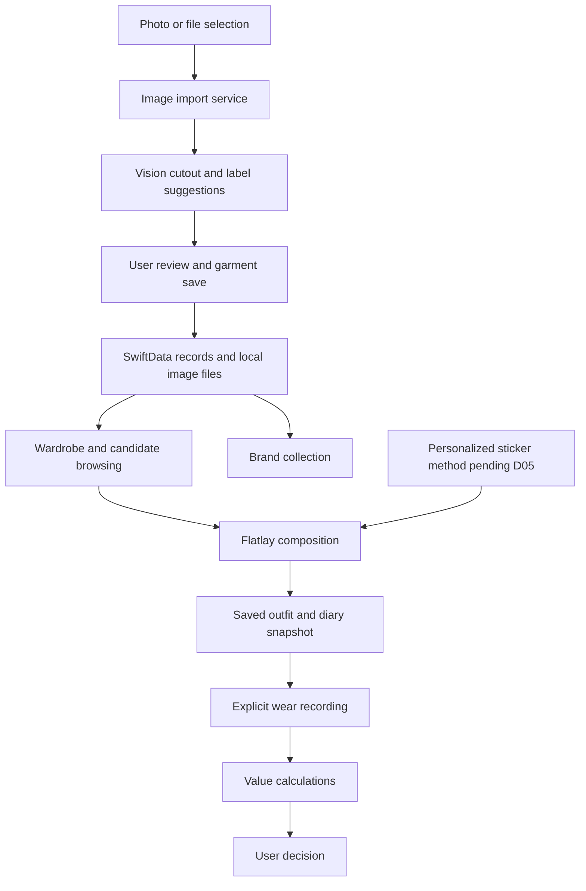

# Wearwise — Technical Specification

## Planning Basis

Sources: scope.md and prd.md, both currently drafts. The learner requested preparation of established work and a consolidated review of unresolved choices. This is the recommended native iOS blueprint following the learner's interest in an iOS app. D01–D07 under Decisions and Open Issues record pending agreement. Ignored local review notes are an optional companion. No application feature is marked complete by this document.

## How This Works, In Plain Language

The iPhone app stores wardrobe records on the phone. Each record points to locally saved images. When the user selects a garment picture, the app processes it, shows a cutout and suggested labels, and saves the user's corrections with the garment.

The flatlay editor reads those cutouts and records where each image is positioned, its size, and its angle. Saving an outfit retains those arrangements. An OOTD entry keeps a snapshot so an older diary remains stable when an outfit is edited later.

Use records belong to the same garment. A small calculation module computes cost per wear and comparisons with personal reference values. The screens display the evidence; the user chooses whether to purchase, keep, or retire an item.

SwiftUI builds the screens, SwiftData stores records between launches, Vision analyzes images, and Foundation supplies dates and decimal arithmetic. These are Apple frameworks. A separate Swift package contains calculations that can be tested without the phone interface.

## The Core Journey Through the System

Implements prd.md > The Core Journey.



## Stack

| Component | Recommendation | Purpose and evidence |
| --- | --- | --- |
| Language | Swift 6 | Native application and shared calculation package; Swift 6.2.3 is installed |
| Interface | SwiftUI | Native controls, layout, gestures, and navigation; [documentation](https://developer.apple.com/documentation/swiftui) |
| Record storage | SwiftData | Local persistence and relationships; [documentation](https://developer.apple.com/documentation/swiftdata) |
| Photo input | PhotosUI PhotosPicker | User-selected images from the photo library; [documentation](https://developer.apple.com/documentation/photosui/photospicker) |
| Image analysis | Vision | Foreground masks and image label suggestions; [subject lifting](https://developer.apple.com/videos/play/wwdc2023/10176/), [classification](https://developer.apple.com/documentation/vision/vnclassifyimagerequest) |
| Pixel processing | Core Image and Core Graphics | Apply masks, normalize orientation, and analyze visible colors; [Core Image](https://developer.apple.com/documentation/coreimage) |
| Composition export | SwiftUI ImageRenderer and ShareLink | Render the actual composition to a saved PNG and share it; [ImageRenderer](https://developer.apple.com/documentation/swiftui/imagerenderer), [ShareLink](https://developer.apple.com/documentation/swiftui/sharelink) |
| Calculation and serialization | Foundation | Decimal amounts, Calendar date calculations, and Codable records; [documentation](https://developer.apple.com/documentation/foundation) |
| Project generation | XcodeGen | Generate a reproducible Xcode project from project.yml; [documentation](https://github.com/yonaskolb/XcodeGen) |
| Verification | Swift Testing; Xcode tests | Real calculations, real storage, UI actions, and image operations; [documentation](https://developer.apple.com/documentation/testing) |

Recommended minimum target: iOS 17, which supports the planned SwiftData and foreground-mask APIs. Confirm the user's device compatibility under D01. Choose dependency versions from supported releases when building; record the actual Xcode and SDK versions in the README after verification.

No cloud API, external inference service, or account system has been selected. The personalized sticker implementation remains pending D05 and must be reflected here after agreement.

## Where It Runs and How Someone Tries It

Target: a native iPhone application. Full Xcode with an iOS SDK and simulator is required for the application target. Physical-device tests are required for supported image operations and actual installation. The current environment cannot perform these checks because full Xcode is absent.

Planned project commands, available after the corresponding files and tools exist:

```sh
xcodegen generate --spec ios/project.yml
open ios/Wearwise.xcodeproj
```

Select the Wearwise scheme and an installed iPhone simulator, then run in Xcode. For an actual iPhone, connect the device and select the user's signing team in Xcode. Apple Account credentials stay in Xcode.

The independent calculation package uses the following standard test command. The current installed PackageDescription interfaces and linked library are inconsistent, so the package test cannot currently start. Independent source checking also fails inside Foundation with duplicated SwiftBridging definitions and an SDK/compiler mismatch. Restore a consistent toolchain through full Xcode setup and rerun; no compilation or runtime pass has been established.

```sh
swift test --package-path packages/WearwiseCore
```

Native app build command after Xcode installation and project generation:

```sh
xcodebuild -project ios/Wearwise.xcodeproj -scheme Wearwise -sdk iphonesimulator -configuration Debug -derivedDataPath .build/ios CODE_SIGNING_ALLOWED=NO build
```

List available simulator destinations before selecting an exact device for UI tests. Do not claim that a simulator verifies physical-device-only behavior. Running and recording the app is separate from publishing it to the App Store or TestFlight.

## Look and Feel

Implements prd.md > Look and Feel.

Carry forward minimal scrapbook-style OOTD and flatlays. Pending D06: warm paper-like backgrounds, charcoal text, muted sage accents, readable system typography, clear image cards, and generous spacing. Use native controls for selection, input, and navigation. Decorative details belong to saved compositions; controls remain readable.

Support Dynamic Type, accessible control labels, and explicit selection controls in addition to canvas gestures. Repository text stays English. Interface language awaits D06.

## Components

### Application Shell and Navigation

Implements prd.md > Screens and Layout, States and Boundaries.

Own the persistent model container and navigation between wardrobe, flatlay composition, diary, and brands. Present garment details and import as focused sheets. Product layout remains a proposal pending D06.

### Image Import Service

Implements prd.md > Image Import and Automatic Tags.

Read PhotosPicker transferable data, a selected image file, explicit image paste, or a dropped image through one decoding service. Decode with ImageIO, normalize orientation, and retain an original asset. Verify JPEG, PNG, and WebP decoding on the target OS before promising those formats. Perform a VNGenerateForegroundInstanceMaskRequest off the main UI execution path. Generate a masked image with transparency; save it as PNG after user review.

The foreground API identifies subjects, which may contain several objects. It does not promise isolation of one garment worn by a person. Evaluate real product images, flatlays, screenshots, and person-worn images; provide explicit subject selection or crop review if required by those supported inputs. This is a technical risk to resolve with real evidence.

Use VNClassifyImageRequest to obtain editable label suggestions. Evaluate whether its vocabulary distinguishes the intended garment categories. Compute visible color from opaque foreground pixels using standard image APIs. Do not infer brand, size, price, season, or condition as facts. If the classifier fails the agreed category criteria, investigate a suitable real Core ML model and document the dependency change before claiming tagging completion.

Keep input and edits available when a declared operation fails. Show an actionable error. Unexpected programming errors remain visible during development; no fabricated cutout or labels are substituted.

### Wardrobe and Asset Store

Implements prd.md > Wardrobe Records, States and Boundaries.

Use SwiftData for metadata and an application-support directory for image files. Saved records use asset identifiers and relative paths. A new image is written successfully before a garment record claims to reference it. Keep originals and chosen cutout versions separate.

Owned, candidate, and retired status are user-controlled. Filters and counts use this status. References from saved outfits and diaries preserve access to existing assets. Do not remove referenced files when replacing a garment's current image.

### Flatlay Editor

Implements prd.md > Freeform Flatlay Composition.

Render layers in order with SwiftUI. Each layer references an asset and optional garment. Persist its normalized position, relative size, rotation, and layer order. Use drag, magnification, and rotation gestures; provide controls for selection, ordering, and removal.

Use a stable logical canvas coordinate system so layouts survive different view sizes. Gestures update the draft composition, then saving persists the complete layout. Rendering and export use the same composition view; selection handles are excluded from export.

### Wear and Value Engine

Implements prd.md > Wear Records and Value, Purchase Decision Support.

Place pure arithmetic and date comparisons in WearwiseCore. Use Decimal for monetary calculations and retain currency codes. Cost per wear is unavailable when price is unknown or count is zero. Validate negative amounts and counts at input boundaries. Compare reference values using the unrounded amount; round only for presentation.

Keep opening estimated wear counts and actual dated events distinguishable. Actual total wears equal the opening count plus recorded wears; the estimate label persists. Purchase projections use a separate estimated future wear count and never modify actual use.

Use Calendar for date-based durations and anniversaries. Label acquisition duration and first-use duration separately. Retain precision for both dates, including estimates. Month-only or year-only inputs define a range of plausible dates; duration displays and reference comparisons must preserve that uncertainty. Exact-date comparisons can use the core anniversary calculation. Do not divide day counts by 365 to decide whether a calendar-year reference has been passed.

### OOTD Journal and Export

Implements prd.md > OOTD Journal and Personalized Stickers.

Save the date, note, complete composition snapshot, and rendered PNG. Snapshots retain canvas dimensions, background, asset references, and transformations independently of the editable outfit. The proposed explicit worn action links a journal entry to one wear per distinct owned garment; repeating that action must not duplicate counts. Repeated layers of one garment do not add extra wears. Proposed D04 policy: later diary date edits leave wear-event dates intact; corrections and reversals require an explicit action; diary deletion retains historical wear events after removing their journal association. D04 must confirm this behavior.

Export actual rendered images through the native share sheet. No direct social-account integration is assumed.

### Personalized Character Stickers

Implements prd.md > OOTD Journal and Personalized Stickers.

The asset store and composition format accept sticker assets. The generation or customization component is pending D05. Its input, output, style, external dependencies, and verification criteria must be established before implementing this component. A generic character cannot be marked as personalized without the agreed customization.

### Brand Collection

Implements prd.md > Brand Inspiration.

Persist brand names, website URLs, notes, and optional inspiration assets. Link garments to saved brands. Brand edits update the shared brand record while preserving garment attributes. Open website links through the system browser.

## Data Model

| Record | Key data | Persistence and relationships |
| --- | --- | --- |
| Garment | Identifier, name, category, color tags, brand, size, seasons, status, amount, currency, acquisition date and precision, optional first-use date and precision, condition, notes, opening wear count and estimate flag, separate projected future-wear estimate, reference values | SwiftData; refers to current original and cutout assets, brand, and wear events; candidate projections persist independently of actual use |
| Asset | Identifier, kind, relative file path, pixel dimensions | SwiftData metadata and local image file; immutable saved versions can be reused by outfits and snapshots |
| Outfit | Identifier, name, canvas dimensions, background, ordered layer data, update date | SwiftData; Codable layer data identifies assets and optional garments |
| Journal entry | Identifier, date, note, outfit identifier, complete composition snapshot including canvas dimensions, background, and layers, rendered asset, worn state | SwiftData; independent snapshot preserves old entries |
| Wear event | Identifier, garment identifier, date, optional journal identifier, count | SwiftData; actual events add to the opening count; repeated journal logging is prevented |
| Brand | Identifier, name, URL, notes, optional inspiration asset | SwiftData; garment associations reference its identifier |
| Preferences | Currency display choice, default reference values, selected personalized sticker configuration | Stored locally; user-editable; exact sticker configuration pending D05 |

Use standard Codable serialization for composition data. Each layer contains an identifier, asset identifier, optional garment identifier, normalized center coordinates, relative dimensions, rotation, and order. Parse with JSONEncoder and JSONDecoder. The normalized canvas plus image dimensions preserves aspect ratios.

All saved data remains in the application container between launches. Cloud synchronization and account identity have not been selected. A personal wardrobe and its images are excluded from Git. The proposed retirement and deletion policies require D04 agreement.

## File Structure

These paths are the proposed architecture; source files do not exist until implemented.

| Path | Responsibility |
| --- | --- |
| ios/project.yml | Reproducible Xcode target, scheme, capabilities, package link, and deployment target |
| ios/Wearwise/App/ | Application entry, model container, and navigation |
| ios/Wearwise/Models/ | Persistent records and Codable composition layers |
| ios/Wearwise/Services/ImageImportService.swift | Real image decoding, subject masks, and label suggestions |
| ios/Wearwise/Services/AssetStore.swift | Local image files and immutable asset versions |
| ios/Wearwise/Services/WearRecordingService.swift | Actual wear events and journal-to-event relationships |
| ios/Wearwise/Features/Wardrobe/ | Browse, filter, import, and garment detail interfaces |
| ios/Wearwise/Features/Flatlay/ | Layer editing and shared composition rendering |
| ios/Wearwise/Features/Journal/ | Diary entry editing, snapshots, and export |
| ios/Wearwise/Features/Stickers/ | Personalized sticker implementation after D05 |
| ios/Wearwise/Features/Brands/ | Brand records and inspiration |
| ios/Wearwise/Design/ | Colors, typography, shared controls, and accessibility |
| ios/Wearwise/Assets.xcassets/ | Application resources with documented rights |
| ios/WearwiseTests/ | Real record, composition, and wear-event tests |
| ios/WearwiseUITests/ | App navigation and integrated journey tests |
| packages/WearwiseCore/ | Foundation-only monetary and duration calculations with Swift Testing |
| devpost/ | Canonical planning, checklist, and final app map; ignored personal profile |
| README.md | Verified installation, running, testing, and demo instructions |
| THIRD_PARTY_NOTICES.md | Required asset and dependency notices |

## External Services and Dependencies

The recommended wardrobe and image-processing design uses on-device Apple frameworks with no external inference endpoint. No API key or per-request billing applies to this architecture. Device installation uses Apple's signing workflow, documented under [Running on devices](https://developer.apple.com/documentation/xcode/running-your-app-on-simulated-or-physical-devices).

XcodeGen is a build-time tool. It generates the Xcode project from YAML. Pin the verified tool version during setup and retain its license notice where required.

Personalized sticker generation may introduce an external dependency after D05. Before choosing one, document its exact request, response, credentials, data handling, cost, and relevant license. Do not send personal images to a service without the user's agreement.

## Important Failure Modes

- The input cannot decode or the foreground detector returns no useful subject: show the failing operation, preserve the input, and require an explicit corrected input or retry.
- Classification suggestions are inaccurate: keep them editable and preserve user corrections. Real-image evaluation determines whether the selected model satisfies D02.
- Saving an asset or record fails: show the failure and preserve the unsaved draft. Do not display a successful save or create a reference to a missing image.
- Xcode or signing setup is missing: report the exact missing tool or configuration. Core-package verification alone cannot establish that the iOS app runs.

## What Was Simplified and Why

No requested product area has been removed or deferred. Device-local storage and native sharing are recommendations pending D01 and D06. Virtual try-on remains excluded by the learner. The final sticker method is deliberately unresolved rather than replaced with a placeholder.

## Verification Approach

Use real Decimal and Calendar calculations in WearwiseCore tests. Verify unknown values, zero count, estimates, comparison boundaries, and leap-year anniversaries.

Use real persistent records and image files to test save/reopen, updates, retirement references, diary snapshots, and repeated worn actions. Do not mock storage or image processing. UI tests must exercise real controls and persisted results. Image analysis must use actual permitted input images and inspect actual cutouts and labels.

Run a full iPhone journey covering import, owned/candidate distinction, flatlay save/reopen, personalized sticker, diary snapshot/export, wear metrics, purchase projections, and brand save/reopen. Record results against PRD criteria. Mark only observed passing behavior complete.

## Decisions and Open Issues

- D01: native iOS, Swift, local persistence, minimum device version, and Xcode setup remain to be accepted.
- D02: exact automatic tag fields and real-image classification quality.
- D03: projected wear-cost evidence for buying decisions.
- D04: actual wear logging, duration meaning, and retirement/deletion behavior.
- D05: personal character input, customization, and generated output.
- D06: presentation, interface language, and review format.
- D07: source license and public delivery authorization.

The learner's identified learning goal is understanding the full product development process. No additional unfamiliar concept has been claimed on their behalf. During implementation, trace a real garment action through its UI, saved record, and calculation to explain how requirements become tested behavior.
